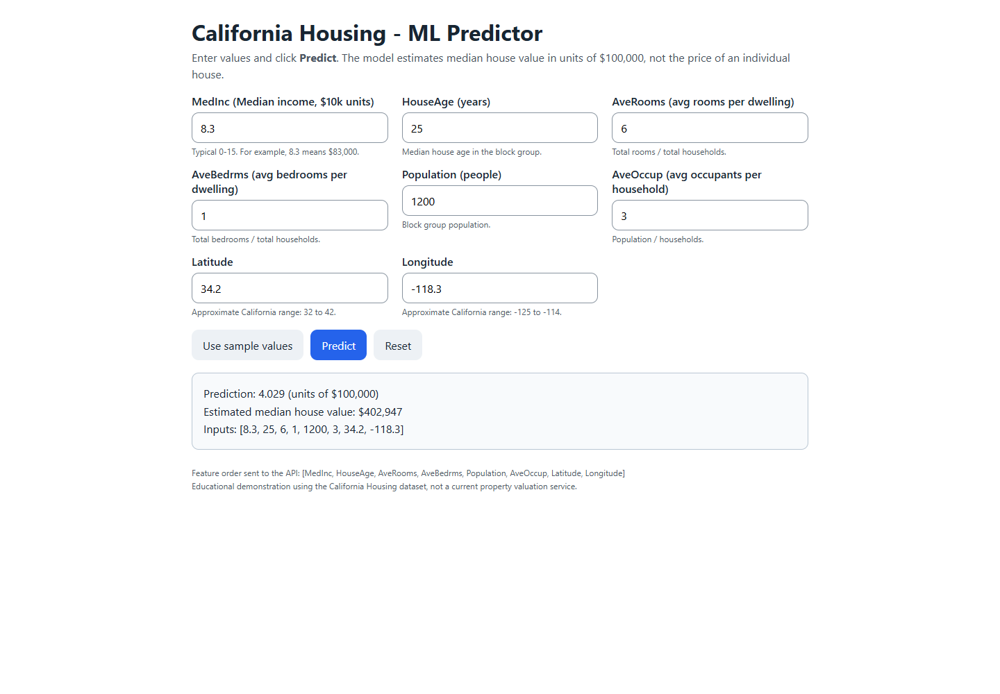
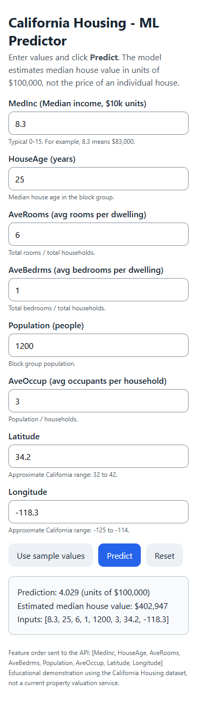

# California Housing - Model as a Service

งาน CPE312: ฝึกโมเดลทำนายค่ามัธยฐานราคาบ้านด้วย Random Forest แล้วให้บริการผ่าน Flask และ Docker

โจทย์ต้นฉบับและตัวอย่างของผู้สอนเก็บไว้ใน [docs/assignment.md](docs/assignment.md)

## สิ่งที่โปรเจกต์ทำ

- ฝึก `RandomForestRegressor(n_estimators=100, random_state=42)` ด้วย California Housing
- แบ่งข้อมูลฝึก 80% และทดสอบ 20% โดยใช้ `random_state=42`
- บันทึกโมเดลที่ `model/model.pkl` และผลประเมินที่ `model/metrics.json`
- เปิดหน้าเว็บกรอกข้อมูล 8 ค่า พร้อมปุ่มตัวอย่าง Predict และ Reset
- ให้บริการ `GET /health` และ `POST /predict` ด้วย JSON
- ตรวจข้อมูลผิดรูปแบบ ค่าที่ไม่ใช่ตัวเลข และค่าที่โมเดลรับไม่ได้ โดยไม่เปิด debug mode

## โครงสร้างไฟล์

```text
ml-deployment-lab/
|-- app.py
|-- train_model.py
|-- requirements.in
|-- requirements.txt
|-- requirements-dev.txt
|-- Dockerfile
|-- templates/main.html
|-- static/main.js
|-- tests/test_service.py
|-- scripts/check_browser.py
|-- docs/
|   |-- assignment.md
|   |-- prediction-desktop.png
|   `-- prediction-mobile.png
|-- model/                         # สร้างตอนฝึก ไม่ส่งขึ้น Git
`-- data/                          # cache ข้อมูล ไม่ส่งขึ้น Git
```

## รันบน Windows ด้วย Python 3.11 และ uv

เปิด PowerShell ในโฟลเดอร์โปรเจกต์ คำสั่งติดตั้งต้องใช้อินเทอร์เน็ต

```powershell
uv venv --python 3.11 .venv
uv pip install --python .venv\Scripts\python.exe -r requirements.txt
.\.venv\Scripts\python.exe train_model.py
.\.venv\Scripts\python.exe app.py
```

ถ้ามี `.venv` และฝึกโมเดลแล้ว ให้รันเพียงคำสั่งสุดท้าย ไม่ต้องสร้าง environment ซ้ำ

เปิด <http://127.0.0.1:5000/> และตรวจสถานะที่ <http://127.0.0.1:5000/health>
กด **Use sample values** แล้ว **Predict** เพื่อทำนาย กด `Ctrl+C` ใน terminal เพื่อหยุดเซิร์ฟเวอร์
Flask server ที่รันด้วย `app.py` ใช้สำหรับทดสอบภายในเครื่องเท่านั้น

หากไม่ใช้ uv สามารถใช้ `python -m venv .venv` และ
`.\.venv\Scripts\python.exe -m pip install -r requirements.txt` แทนสองคำสั่งแรกได้
โดยต้องมี Python 3.11 ติดตั้งและเรียกผ่าน `python` ได้ก่อน
Gunicorn ติดตั้งเฉพาะ Linux และใช้ตอนรัน Docker ไม่ใช้โดยตรงบน Windows

## Build และ Run ด้วย Docker

ต้องติดตั้งและเปิด Docker Desktop ในโหมด Linux containers ก่อน
ครั้งแรกต้องมีอินเทอร์เน็ตสำหรับ base image, dependencies และชุดข้อมูล
Dockerfile ฝึกโมเดลระหว่าง build จึงไม่ต้องส่งไฟล์โมเดลขึ้น Git

```powershell
docker build -t ds-ml-service .
docker run --rm -p 127.0.0.1:5000:5000 ds-ml-service
```

ถ้า PowerShell หา `docker` ไม่พบ แต่ติดตั้ง Docker Desktop แบบ per-user อยู่แล้ว
เพิ่ม CLI เข้า PATH เฉพาะ terminal ปัจจุบันก่อนรันคำสั่งข้างต้น:

```powershell
$env:PATH = "$env:LOCALAPPDATA\Programs\DockerDesktop\resources\bin;$env:PATH"
docker version
```

เปิด <http://127.0.0.1:5000/> เช่นเดียวกับการรัน Python
คอนเทนเนอร์ใช้ Gunicorn 2 workers และรันด้วยผู้ใช้ที่ไม่ใช่ root
การ map port นี้เปิดให้ใช้เฉพาะเครื่องตนเอง ไม่เผยแพร่ไปยังเครือข่าย
หากพอร์ตถูกใช้งาน เปลี่ยนเป็น `-p 127.0.0.1:8080:5000` แล้วเปิดพอร์ต `8080` แทน
กด `Ctrl+C` เพื่อหยุดคอนเทนเนอร์

## ทดสอบ API

ลำดับข้อมูลต้องเป็น:

```text
[MedInc, HouseAge, AveRooms, AveBedrms, Population, AveOccup, Latitude, Longitude]
```

```powershell
Invoke-RestMethod -Uri http://127.0.0.1:5000/health
Invoke-RestMethod -Uri http://127.0.0.1:5000/predict -Method Post -ContentType "application/json" -Body '{"features":[8.3,25.0,6.0,1.0,1200,3.0,34.2,-118.3]}'
```

ผลที่ตรวจได้จากโมเดลที่ฝึกในเครื่องนี้:

```json
{"prediction": 4.029472199999998}
```

หน่วยคือ **100,000 ดอลลาร์สหรัฐ** ผลนี้จึงเท่ากับประมาณ **402,947 ดอลลาร์**
ค่าทศนิยมท้ายอาจต่างกันเล็กน้อยระหว่างเวอร์ชันแพ็กเกจ
ข้อมูลนี้เป็นการสาธิตด้วยชุดข้อมูล California Housing ไม่ใช่การประเมินราคาบ้านปัจจุบันหรือบ้านรายหลัง

API รับเฉพาะ array ที่มีตัวเลขจริงครบ 8 ค่า ไม่รับข้อความ boolean, null, NaN หรือ Infinity
ข้อมูลไม่ถูกต้องตอบ `400` พร้อม `{"error": "..."}`; request ใหญ่เกิน 16 KiB ตอบ `413`
ช่วง min/max ในหน้าเว็บเป็นตัวช่วยกรอกข้อมูลตามโจทย์ ไม่ใช่ข้อจำกัดทางภูมิศาสตร์ของ API

## ทดสอบอัตโนมัติ

ฝึกโมเดลก่อน แล้วรันชุดทดสอบที่ใช้โมเดลจริง:

```powershell
.\.venv\Scripts\python.exe -W error -m unittest discover -s tests -v
node --check static/main.js
```

ทดสอบหน้าเว็บด้วย Microsoft Edge แบบ headless และสร้างภาพหน้าจอใหม่:

```powershell
uv pip install --python .venv\Scripts\python.exe -r requirements-dev.txt
.\.venv\Scripts\python.exe scripts/check_browser.py
```

คำสั่ง browser ต้องมี Microsoft Edge ติดตั้งอยู่ และจะเปิดเซิร์ฟเวอร์ชั่วคราวบน loopback
ทดสอบการทำนายจริง การแปลงหน่วย Reset การกรอกไม่ครบ ข้อผิดพลาดเครือข่าย/การลองใหม่
การยกเลิก request และแบบฟอร์มเมื่อปิด JavaScript
มีการจำลอง network failure และ error response เฉพาะกรณีทดสอบข้อผิดพลาด
ภาพหน้าจอการทำนายใช้ API และโมเดลจริง ไม่ใช่ผลจำลอง
ตรวจหน้าจอกว้าง 320, 768, 1024 และ 1440 px และปิด browser/server เมื่อจบ

## ภาพผลทำนายจริง





## ผลประเมินโมเดล

ผลจากการฝึกวันที่ 16 พฤศจิกายน 2026 ด้วย Python 3.11.17:

| รายการ | ผล |
| --- | --- |
| จำนวนแถวฝึก | 16,512 |
| จำนวนแถวทดสอบ | 4,128 |
| R² | 0.804624 |
| RMSE | 0.505986 หรือประมาณ 50,599 ดอลลาร์ |
| MAE | 0.327731 หรือประมาณ 32,773 ดอลลาร์ |

RMSE/MAE เป็นผลประเมินบน test split ไม่ใช่การรับประกันความคลาดเคลื่อนสำหรับข้อมูลใหม่

## สถานะการตรวจและสิ่งที่ยังต้องทำ

- ฝึกโมเดลจริง และทดสอบ Python 17 ข้อผ่านด้วย `-W error` บน Windows แล้ว
- ทดสอบเว็บด้วย Microsoft Edge แบบ headless ผ่าน รวม viewport 320, 768, 1024 และ 1440 px
- ตรวจ resolve dependencies สำหรับ Linux/Python 3.11 แบบ dry-run ผ่าน (ไม่ใช่การ build Docker)
- วันที่ 16 พฤศจิกายน 2026: Docker build/run ผ่านด้วย image `ds-ml-service:lab-verify-20261116`
- ทดสอบใน Linux container ด้วย `python -W error -m unittest discover -s tests -v`: 17 ข้อผ่านใน 12.001 วินาที และ `python -m pip check` ผ่าน
- ทดสอบ HTTP ของคอนเทนเนอร์จริง: health, prediction, invalid payload 11 แบบ, HTTP 400/405/413, HTML/static และ prediction พร้อมกัน 8 requests ผ่าน
- Edge แบบ headless ทดสอบคอนเทนเนอร์จริงผ่าน: prediction `4.029472199999998`, USD 402,947, responsive, Reset, network error/retry และแบบฟอร์มเมื่อปิด JavaScript
- ยืนยัน Gunicorn 2 workers และผู้ใช้ `appuser` (UID 1000); bind เฉพาะ loopback และหยุดคอนเทนเนอร์ทดสอบทั้งสองแล้ว โดยเก็บ image ไว้
- ยังไม่มี independent review และยังไม่ commit, push, deploy หรือส่ง Google Form
- ไม่เก็บ `.venv`, dataset cache, model, `.env` และไฟล์ชั่วคราวใน Git
- โหลดเฉพาะ `model.pkl` ที่ฝึกจากโปรเจกต์นี้เอง ไม่ใช้ไฟล์ pickle จากแหล่งที่ไม่เชื่อถือ

## ส่งงาน

1. ตรวจโค้ด README และภาพหน้าจอให้ตรงกับเกณฑ์ส่งงาน
2. Push ไปยัง GitHub ของตนเองเมื่อพร้อมส่ง
3. ส่งลิงก์ repository ผ่าน Google Form ที่ระบุในโจทย์ต้นฉบับ

การ push และส่งแบบฟอร์มเป็นขั้นตอนแยก ไม่ได้ดำเนินการอัตโนมัติ
